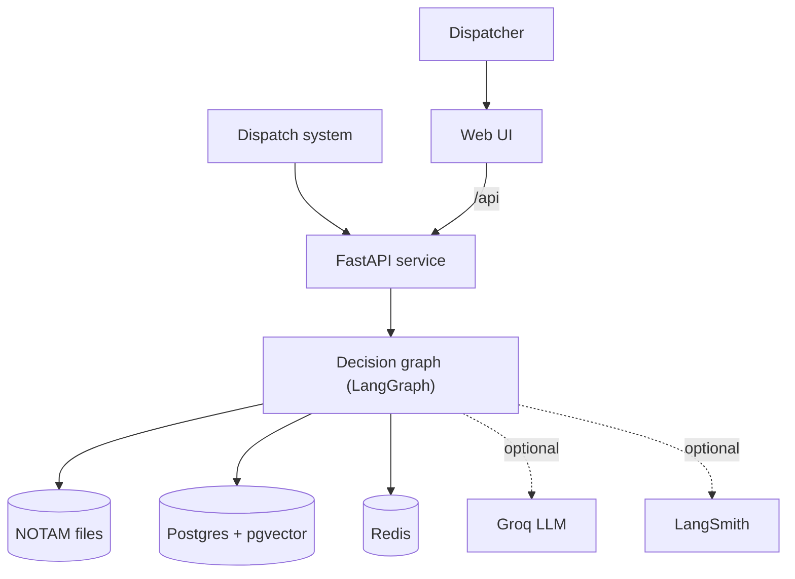
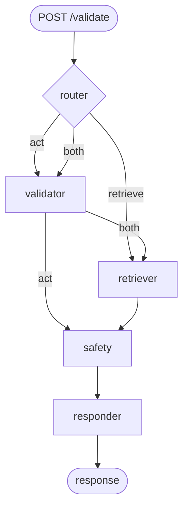
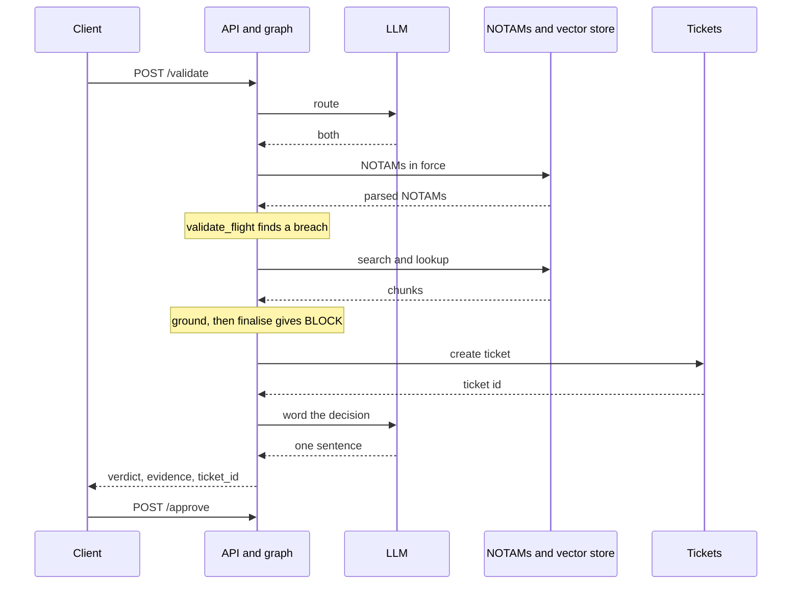
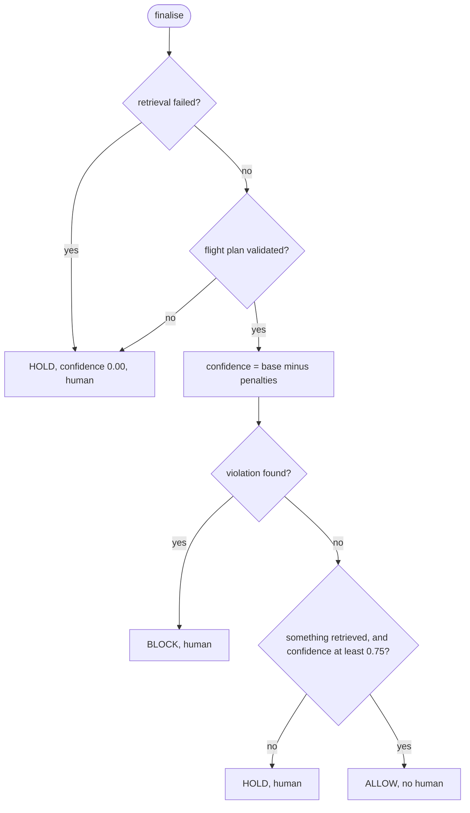

# NOTAM-Guard: High-Level and Low-Level Design

- Author: Komma Bhanu Teja
- Status: working prototype, version 0.2.0, last updated 2026-10-14
- Code: https://github.com/maczeo11/notam-guard

NOTAM-Guard decides whether a drone flight may launch. Given a position, an altitude and a drone id, it returns `ALLOW`, `BLOCK` or `HOLD`, along with the rule it relied on and the text of that rule.

It is a prototype. The decision logic, API, tests and web interface are complete. The data is small on purpose (four DGCA clauses and three sample NOTAMs), and the system has not been run against live data.

---

# Part 1: High-level design

## 1. Problem and scope

A dispatcher proposes a flight: where, how high above the ground, which drone, and optionally when. The system returns one of three verdicts.

| Verdict | Meaning | Human review |
|---|---|---|
| `ALLOW` | No rule is breached, and the evidence is strong enough to clear the flight | No |
| `BLOCK` | A rule is breached | Always |
| `HOLD` | The system cannot justify a decision, for example because it could not read the regulations | Always |

The two mistakes do not cost the same. Blocking a legal flight loses a mission. Allowing an illegal one can lose an aircraft. So the design leans one way: when in doubt, hold.

**In scope:** the DGCA micro-RPA ceiling (CAR §7, 120 m above ground), NOTAMs described as a circle with an altitude limit and a validity window, returning the rule that was applied with its text, and a human approval step.

**Out of scope:** terrain, weather, airspace class, other traffic, fleet orchestration, authentication, and real NOTAM formats such as ICAO Q-codes.

## 2. Architecture



A FastAPI service wraps a five-node LangGraph state machine. The graph uses two kinds of data. Parsed NOTAMs, read from text files, drive the verdict. Regulation text, held in a vector store, is used only to show and check what the verdict relied on. Tickets for flights that need a person live in Redis, or in DynamoDB when `TICKET_STORE=dynamodb`.

| Component | Role | If it is missing |
|---|---|---|
| Web UI | Shows the verdict, its evidence and a map of NOTAM circles | Optional |
| API | Validates input and shapes responses | Required |
| Decision graph | Turns a flight plan into a decision | Required |
| NOTAM files | The airspace restrictions the verdict is computed from | Flight is held |
| Vector store | Regulation text for grounding citations | Flight is held. An in-memory store can be chosen instead by configuration, but there is no automatic fallback |
| Redis | Idempotent tickets and per-drone history | Falls back to in-process storage |
| DynamoDB (optional) | Idempotent tickets, instead of Redis | Falls back to in-process storage at start. A request it refuses returns the verdict with no ticket |
| Groq LLM | Routing and wording | Falls back to a rule-based adapter |
| LangSmith | Traces of each node | Off by default |

The decision logic imports no database, cache or LLM library. It talks to five interfaces (ports), and each has a real implementation and an in-memory one. That is why the test suite needs no infrastructure.

## 3. How a request is decided



- **router** chooses a route: `retrieve`, `act` or `both`.
- **validator** does the arithmetic. It checks the altitude ceiling and the NOTAM circles and records which rules it applied.
- **retriever** fetches regulation text: a similarity search for context, plus an exact lookup of the rules the validator applied.
- **safety** checks the citations, applies the safety policy and opens a ticket when a person must look. It is the only node that sets a verdict.
- **responder** turns the finished decision into one sentence for the operator.

The language model does two things only: it picks the route and it words the sentence. The safety node runs before the responder, so the model is always handed a decision that is already final.

| Route | Nodes that run | Effect on the verdict |
|---|---|---|
| `both` | router, validator, retriever, safety, responder | The full check |
| `act` | router, validator, safety, responder | Nothing is retrieved to support the verdict, so the flight is held unless it is a breach |
| `retrieve` | router, retriever, safety, responder | The validator never runs, so the flight is always held |



## 4. The safety policy



Two kinds of problem are handled in two different ways.

**A check that did not happen holds the flight outright.** That covers a plan the validator never saw and a verdict with nothing retrieved to support it. These are not treated as small deductions, because then the outcome would depend on how unrelated penalties happen to add up.

**Evidence that is weaker than it should be lowers confidence.** Confidence starts at 1.00 for a clear flight and 0.95 for a breach. An `ALLOW` needs at least 0.75.

| Defect | Cost |
|---|---|
| A restrictive NOTAM with no coordinates, so it cannot be checked | 0.15 each |
| A cited rule that no retrieved text defines | 0.40 each |
| Nothing retrieved at all | 0.40 (and the flight is held) |

| Example | Result |
|---|---|
| Crane breach, with the unplaceable runway NOTAM in force | `BLOCK` at 0.80 |
| Clear flight, same airspace | `ALLOW` at 0.85 |
| Plan with no regulatory wording, so the `act` route | `HOLD` at 0.45 |
| Router sends a 500 m flight down `retrieve` | `HOLD` at 0.00 |

A `BLOCK` is never downgraded by weak evidence, only made less confident. It still always goes to a person, because refusing a mission has a cost too.

## 5. Data

The same source files are used in two ways. The structured view is what a parser makes of each NOTAM line: coordinates, radius, altitude limit, validity window and severity. This drives the verdict. The text view is the files cut into one chunk per line and indexed for retrieval. This is only used to show what the verdict relied on.

| File | Content |
|---|---|
| `data/dgca_car.txt` | A title line and four clauses: §7 (micro RPA, 120 m), §8, §9 and §12 |
| `notam_0903_crane.txt` | A crane with a 100 m limit in a 1 km radius |
| `notam_0904_runway.txt` | A runway closure with a 5 km no-fly zone and no coordinates. Deliberately unplaceable |
| `notam_0905_bird.txt` | Bird activity with no stated limit, so an advisory that never blocks |

That gives 8 chunks. The sample validity windows are fictional and run to 2027-12-31, and a test fails 60 days before they end, so the demo cannot quietly change behaviour as the calendar moves.

## 6. Failure handling

Retrieval may not degrade quietly. Redis, the LLM and tracing may, because they are conveniences. The regulations are evidence.

| What goes wrong | What happens |
|---|---|
| Vector store unreachable, or returns nothing | `HOLD`, confidence 0, even if the geometry shows a breach |
| NOTAM source missing or empty | Nothing is validated, so `HOLD` |
| A NOTAM has no coordinates | Kept, reported on every decision, 0.15 off confidence |
| A NOTAM's dates cannot be parsed | Treated as active, so a restriction is never dropped by accident |
| LLM provider fails | The rule-based adapter takes over. The verdict is unaffected |
| Redis unreachable | Tickets become process-local, with a warning |
| DynamoDB refuses or throttles a ticket write | The verdict is returned unchanged with a warning and no ticket, so the flight stays held. `/approve` returns 503 until it recovers |

## 7. Design decisions

**The model routes and words; code decides.** A language model reads free text well and is a poor last line of defence before a clearance. Because the route decides which checks run, a skipped check is a hold, so a bad route cannot clear a flight.

**A citation must define the rule, not mention it.** The crane NOTAM says "DGCA CAR §7 applies". That sentence does not count as the text of §7. A reference is grounded only where it starts a chunk or a sentence, as a whole number, so `§7` is not satisfied by `§70`.

**Cited rules are looked up by name.** An identifier like `§7` means little to a similarity ranker, and similarity search alone missed the applied rule on 2 of 14 test queries. The rules the validator applied are known, so the retriever fetches them directly and lists them first.

**Retrieval and the gate are measured separately.** The evaluation scores similarity search on its own (0.857) and the full gate (1.0). Folding the lookup into the first number would hide the retriever's weakness.

**First approval wins.** Closing the human gate twice should not change who closed it. Approval runs under a Redis `WATCH` transaction, or as one conditional update in DynamoDB, and keeps the ticket's expiry.

## 8. Deployment

The service runs in two modes. With `VECTOR_ADAPTER=memory` and `LLM_ADAPTER=rule` it needs only Python: retrieval is lexical, routing is rule-based, and tickets are held in the process. The verdict logic is identical. With `docker compose up -d` it runs with Postgres and pgvector, Redis, the API and the web UI, and `python -m src.ingest` loads the corpus. A container image is built from `Dockerfile.api`.

## 9. Limitations

- The data is tiny and was not tested at scale.
- Real NOTAM formats and recurring daily windows are not parsed.
- Terrain, weather and other traffic are not modelled. Altitude is assumed to be above ground level.
- The approval step has no authentication.
- Postgres and Redis are tested through fakes. The DynamoDB store is tested with moto, and its concurrency checks have been run against a real table. The Groq adapter has not been run against a live provider.

---

# Part 2: Low-level design

## 10. Code layout

```
src/
  app.py              FastAPI endpoints and request/response models
  graph.py            graph state, the five nodes, routing, graph build
  tools.py            Haversine distance and validate_flight (no LLM, no I/O)
  ingest.py           loads the corpus into pgvector
  eval.py             scores the 16-case golden set
  core/
    domain.py         dataclasses and enums
    ports.py          the five interfaces
    container.py      picks an implementation per interface
    notam_parser.py   NOTAM text into structured records
    citations.py      finds and grounds rule references
    safety.py         finalise(): the verdict policy
    config.py         every environment variable, read once
  adapters/           pgvector, Redis, tickets, NOTAM files, LLMs
tests/                11 test files
web/src/              React and TypeScript interface
```

## 11. Domain types

| Type | Fields and rules |
|---|---|
| `FlightPlan` | `lat`, `lon`, `alt`, `drone_id`, `query`, optional `at` (the flight time; defaults to now) |
| `Notam` | id, text, position, radius, altitude limit, validity window, severity. Placeable only if position and radius are present. A NOTAM with no stated window is always active |
| `ValidationResult` | `violation`, `reason`, the references applied, advisories, warnings. Contains no LLM text |
| `Citation` | `ref`, `grounded`, `excerpt` (the retrieved text, starting at the definition) |
| `Ticket` | id, dedupe key, status (`open` or `approved`), `approved_by` |
| `Decision` | verdict, reason, confidence, citations, warnings, `requires_human`, ticket id, route |

`Verdict` is `ALLOW`, `BLOCK` or `HOLD`. `Severity` is `restrictive` (a breach blocks) or `advisory` (reported, never blocks).

## 12. Interfaces and implementations

| Interface | Real | In-memory | Contract |
|---|---|---|---|
| `VectorStorePort` | `PgVectorAdapter` | `InMemoryVectorAdapter` | `search(query, k)` and `lookup(refs)`. Must raise on failure, never return placeholder text |
| `NotamRepositoryPort` | `FileNotamRepository` | `InMemoryNotamRepository` | NOTAMs in force at a given time |
| `TicketPort` | `RedisTicketAdapter` or `DynamoTicketAdapter` | `InMemoryTicketAdapter` | Exactly one ticket per drone, NOTAM and day. First approval wins |
| `MemoryPort` | `RedisMemoryAdapter` | `InMemoryMemoryAdapter` | A drone's last five tickets |
| `LLMPort` | `GroqLLMAdapter` | `RuleLLMAdapter` | `route` returns a route; `respond` words a sentence and never changes the verdict |

`core/container.py` picks the implementation once per process from configuration, and falls back to in-memory storage when Redis, or the DynamoDB table, is unreachable. Tests swap in their own implementations through `container.override(...)`.

## 13. Graph nodes

| Node | Reads | Writes |
|---|---|---|
| router | query, coordinates | `action` |
| validator | the flight plan | `validated`, `violation`, `refs`, `reason`, advisories, warnings |
| retriever | query, `refs` | `retrieved`, `retrieval_failed` |
| safety | everything above | `verdict`, `confidence`, `requires_human`, citations, ticket id |
| responder | verdict, reason, citations | the operator sentence |

Routing is two small functions. After the router, `retrieve` goes to the retriever and everything else to the validator. After the validator, `both` goes to the retriever and `act` goes straight to safety. Each node records its own latency.

## 14. Key algorithms

**Validating a flight** (`tools.validate_flight`):

1. Warn about every restrictive NOTAM that cannot be placed.
2. If the altitude is above 120 m, return a breach citing CAR §7. This comes before any NOTAM check.
3. For each NOTAM whose circle contains the position (Haversine distance within the radius), record advisories and collect breaches where the altitude is above the NOTAM's limit.
4. If there are breaches, report the one with the lowest ceiling first and cite all of them, so the answer does not depend on the order of the input.
5. Otherwise return no breach, citing CAR §7.

Comparisons are strict: 120 m is legal and 121 m is not.

**Parsing a NOTAM** (`core/notam_parser.py`): regular expressions extract the id (`NOTAM dd/dd`), the position, the radius, the altitude limit (zero for a no-fly zone, otherwise an explicit "max" limit, otherwise an obstacle's height) and the date window. A NOTAM is restrictive only if it states a limit; with advisory wording such as "caution" and no explicit limit, it becomes an advisory.

**Grounding a citation** (`core/citations.py`): a reference counts only where a retrieved chunk defines it, meaning it starts the chunk or a sentence, as a whole number.

| Chunk | Defines `CAR §7`? |
|---|---|
| `§7 Micro RPA ...` | Yes |
| `§8 Nano RPA. §7 Micro RPA ...` | Yes, the excerpt starts at §7 |
| `... DGCA CAR §7 applies.` | No, it is a mention |
| `§70 ...` | No, it is a different number |

**The verdict** (`core/safety.finalise`):

```
if retrieval failed:        HOLD, 0.0
if not validated:           HOLD, 0.0
base       = 0.95 if breach else 1.00
penalty    = 0.15 per unplaceable NOTAM
           + 0.40 per ungrounded citation
           + 0.40 if nothing was retrieved
confidence = max(0, base - penalty)
if breach:                                   BLOCK
if nothing retrieved or confidence < 0.75:   HOLD
otherwise:                                   ALLOW
```

**Tickets** (`adapters/ticket_adapter.py`): the dedupe key is a hash of the drone id, the NOTAM id and the date. Creation is one atomic Redis `SET key id NX EX ttl`, so when several processes race, exactly one creates the ticket and the rest receive its id. Approval is a read-check-write inside a `WATCH` transaction: an already-approved ticket is returned unchanged, and the write keeps the existing expiry. `DynamoTicketAdapter` gives the same guarantees with conditional writes: creation is one transaction that takes the dedupe item and writes the ticket, and approval is one update that applies only while the ticket is not yet approved. It checks `expires_at` itself on every read, because DynamoDB's TTL deletes expired items lazily, up to a couple of days late.

**Retrieval** (`adapters/pgvector_adapter.py`): similarity search orders chunks by cosine distance to the query embedding (`bge-small-en-v1.5`, 384 dimensions). The lookup narrows candidates with a parameterised `ILIKE` and then applies the grounding rule in Python, so a chunk that only mentions `§7` is not returned as §7. Any database error is raised as a retrieval failure, which holds the flight.

## 15. API

| Method | Path | Purpose |
|---|---|---|
| POST | `/validate` | Decide one flight plan |
| GET | `/ticket/{id}` | Ticket status and approver |
| POST | `/approve/{id}` | Close the human gate. The first approval stands |
| GET | `/notams` | The parsed NOTAMs, including any that could not be placed |
| GET | `/drone/{id}/history` | A drone's recent tickets |
| GET | `/health` | Liveness |

`POST /validate` takes `lat` (-90 to 90), `lon` (-180 to 180), `alt` (0 to 10000 m), `drone_id`, an optional `query`, and an optional `scheduled_for` time at which NOTAM windows are evaluated. Invalid input returns 422. The response carries the verdict, a one-sentence reason, the confidence, the citations with their excerpts, advisories, warnings, whether a person must act, the ticket id and the route taken.

```json
{
  "verdict": "BLOCK",
  "reason": "BLOCK: NOTAM 09/03: max 100m within 1.0km ... reduce to 80m",
  "confidence": 0.8,
  "evidence": [{"ref": "NOTAM 09/03", "grounded": true,
                "excerpt": "NOTAM 09/03 Pune Site: Crane 100m at ..."}],
  "requires_human": true,
  "ticket_id": "T-XXXXXX",
  "action": "both"
}
```

## 16. Storage

Postgres holds one table, `sop_chunks(id, doc_id, chunk, embedding vector(384))`, with an IVFFlat cosine index. Ingest replaces its contents in one transaction and fails loudly rather than leaving an empty table, since an empty table would hold every flight without saying why.

| Redis key | Value | Expiry |
|---|---|---|
| `ticket:dedupe:<hash>` | The ticket id that won | 24 hours |
| `ticket:<id>` | The ticket as JSON | 24 hours, kept on approval |
| `drone:<id>:history` | The last five ticket ids | none |

## 17. Configuration

All settings are read in `src/core/config.py`.

| Variable | Default | Meaning |
|---|---|---|
| `VECTOR_ADAPTER` | `pgvector` | `pgvector` or `memory` |
| `LLM_ADAPTER` | `groq` if a key is set, else `rule` | Routing and wording backend |
| `DATABASE_URL`, `REDIS_URL` | local defaults | Connections |
| `RETRIEVAL_K` | 3 | Chunks per similarity search |
| `MAX_AGL_M` | 120 | DGCA ceiling |
| `HUMAN_GATE_CONFIDENCE` | 0.75 | Below this an `ALLOW` becomes a `HOLD` |
| `TICKET_TTL_SECONDS` | 86400 | Ticket lifetime and dedupe window |
| `LANGSMITH_TRACING`, `LANGSMITH_API_KEY` | off | Tracing |

## 18. Testing and evaluation

There are 127 tests, of which 126 run by default; the remaining one needs a real Redis. They cover the altitude and radius boundaries on both sides, NOTAM parsing, the grounding rule, every branch of the safety policy, each route through the graph, the lookup for both stores, ticket creation under 50 concurrent callers (through the in-memory lock and through a Redis-compatible fake), concurrent approvals, ingest chunking, the router's keyword matching, and the API. They need no Postgres, Redis or API key.

A separate evaluation scores 16 fixed queries at a fixed date, so results do not drift with the calendar.

| Metric | Value | What it shows |
|---|---|---|
| Routing accuracy | 1.0 | The router took the expected branch |
| Verdict accuracy | 1.0 | The arithmetic still gives the expected verdicts (a regression check) |
| Retrieval hit rate | 0.857 | Similarity search alone found the defining text in 12 of 14 cases |
| Grounded citation rate | 1.0 | After the exact lookup, every citation was grounded |

While writing this design I replayed the system at different dates and found two bugs that let unchecked flights through. A request routed past the validator came back `ALLOW` for a 500 m flight, and an unchecked plan was held only because of an unrelated warning in the sample data. Both are fixed, each with a test that failed before the fix.

## 19. Running it

```bash
git clone https://github.com/maczeo11/notam-guard && cd notam-guard
python -m venv .venv
source .venv/bin/activate      # on Windows: .venv\Scripts\activate
pip install -r requirements-dev.txt

VECTOR_ADAPTER=memory LLM_ADAPTER=rule python -m pytest
VECTOR_ADAPTER=memory LLM_ADAPTER=rule python src/eval.py
VECTOR_ADAPTER=memory LLM_ADAPTER=rule uvicorn src.app:app --port 8000
```
